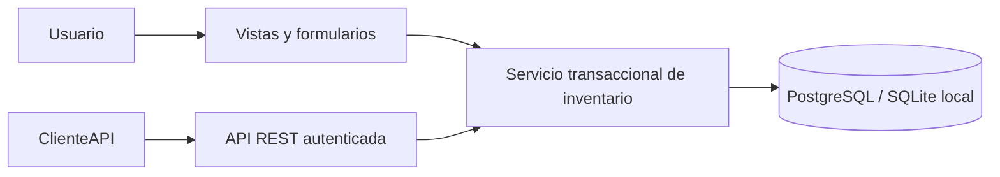

# Arquitectura y modelo de datos

## Arquitectura actual

StockFlow es un monolito Django con una aplicación de dominio, `apps.inventario`. Las vistas HTML y la API llaman al mismo servicio `record_movement`; así las reglas de stock se aplican igual en ambos puntos de entrada.



El admin administra catálogo y cuentas. Movimientos y saldos se muestran de solo lectura: el admin no permite crear, editar o borrar filas que evadan el servicio.

## Modelo implementado

```mermaid
erDiagram
    CATEGORY ||--o{ PRODUCT : clasifica
    SUPPLIER o|--o{ PRODUCT : proveedor_principal
    PRODUCT ||--o{ STOCK_BALANCE : tiene
    LOCATION ||--o{ STOCK_BALANCE : contiene
    PRODUCT ||--o{ MOVEMENT : afecta
    LOCATION ||--o{ MOVEMENT : ocurre_en
    USER ||--o{ MOVEMENT : registra
    MOVEMENT o|--o{ MOVEMENT : corrects_reservado

    PRODUCT {
        string sku UK
        string name
        string unit
        int minimum
        bool active
    }
    STOCK_BALANCE {
        int quantity
        unique product_location
    }
    MOVEMENT {
        string kind "IN | OUT | ADJUST"
        int quantity
        string reason
        datetime created_at
        fk user
        fk corrects "reservado; sin flujo público"
    }
```

`Product.supplier` es una referencia opcional a un solo proveedor. La relación múltiple producto–proveedor y el SKU del proveedor no están implementados. Los movimientos no tienen borradores: se crean confirmados al terminar la transacción.

## Historial y saldo

`Movement` explica cada cambio. `StockBalance` guarda la proyección por par producto–ubicación para consultar el disponible.

- IN: cantidad positiva; suma.
- OUT: cantidad positiva; resta.
- ADJUST: diferencia firmada distinta de cero; suma o resta.
- `delta` representa el efecto real y `signed_quantity` lo muestra con un solo signo.

El stock inicial también es una entrada. No se suma otra cantidad inicial por fuera del historial.

## Integridad y concurrencia

- SKU único y saldo único por producto–ubicación.
- Restricción en base de datos para impedir saldo negativo.
- Restricción para tipos y cantidades de movimiento válidos.
- Servicio que valida motivo, entidad activa, autor, rango entero y saldo resultante.
- `transaction.atomic()` abarca la creación del saldo si falta, el movimiento y la actualización.
- `select_for_update()` bloquea la fila de saldo en PostgreSQL. Una segunda salida espera y valida contra el saldo actualizado.
- Si una escritura falla, toda la operación revierte.
- Las claves de movimientos y saldos usan `PROTECT` para preservar el historial.
- Archivar productos cambia `active`; su detalle e historial siguen disponibles.

SQLite permite la revisión local, pero no demuestra el bloqueo por fila. La suite incluye una prueba concurrente que requiere PostgreSQL.

## Autorización

Se usa el usuario estándar de Django. `is_staff=True` identifica administración en la interfaz; un usuario autenticado sin ese indicador es operador. Los permisos de catálogo se comprueban en el servidor antes de validar o guardar cambios.

El acceso al admin también depende de los permisos estándar de Django. Los nuevos usuarios staff necesitan permisos de los modelos correspondientes, o ser superusuarios.

## API

- `GET /api/v1/productos/`: productos activos, búsqueda por SKU, nombre o categoría.
- `GET /api/v1/movimientos/`: historial.
- `POST /api/v1/movimientos/`: operación por el mismo servicio de stock.
- Las listas son paginadas: 25 resultados por defecto y máximo 100.
- El autor de un movimiento se fija desde el usuario autenticado.
- Errores de negocio devuelven HTTP 400; peticiones sin autenticación no acceden al inventario.

Edición REST del catálogo, filtros avanzados y OpenAPI siguen pendientes.
