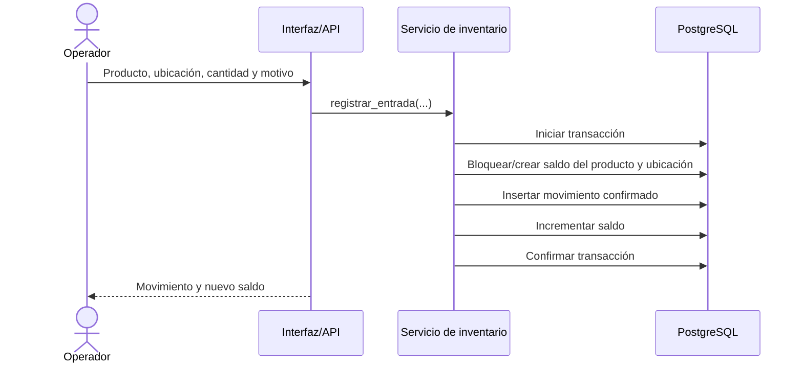

# Flujos de inventario

## Acciones rápidas desde el producto

En el detalle de cada producto se puede ajustar stock indicando movimiento, ubicación, cantidad y motivo. El producto queda fijado por contexto, así no hay que buscarlo de nuevo. Desde el mismo panel, administración puede cambiar rápidamente el nombre o el mínimo de reposición. El formulario de movimientos completo también puede abrirse con el producto preseleccionado.

## Entrada

## Salida

1. El operador indica producto, ubicación, cantidad y motivo.
2. El servicio inicia una transacción y bloquea el saldo correspondiente.
3. Si el saldo es insuficiente, rechaza la operación y no crea movimiento.
4. Si hay disponibilidad, registra la salida y descuenta la cantidad en la misma transacción.
5. Devuelve el movimiento y el saldo actualizado.

Dos salidas simultáneas sobre el mismo saldo deben serializarse en la fila bloqueada. La segunda vuelve a comprobar la existencia después de que la primera confirma.

## Ajuste por conteo físico

1. El usuario calcula y registra el delta firmado entre cantidad física contada y saldo del sistema.
2. El servicio obtiene el saldo actual bajo bloqueo y aplica el delta.
3. Si el delta es cero, no genera movimiento innecesario.
4. Si cambia, guarda un movimiento de ajuste con delta firmado, motivo obligatorio y saldo resultante.
5. Si el nuevo saldo es negativo (por dato inválido), rechaza la operación.

## Corrección de un movimiento

Un movimiento confirmado no se edita. El usuario autorizado crea un movimiento compensatorio ligado al original y explica el motivo. La corrección respeta las mismas reglas de saldo y permisos. La interfaz muestra juntos el movimiento original y su corrección.

## Reposición

Para cada producto activo, el reporte suma sus saldos por ubicación. Si el total es menor o igual al mínimo configurado (y el mínimo es mayor que cero), aparece como pendiente de reposición. El reporte informa saldos por ubicación para ayudar a decidir si basta un traslado manual futuro; los traslados quedan fuera del MVP.

## Estados

Los movimientos se crean confirmados mediante una operación atómica. No se incluyen borradores en el MVP: evita tener cantidades “pendientes” mezcladas con el disponible. Un flujo de aprobación se podrá añadir cuando exista un caso real que lo justifique.
